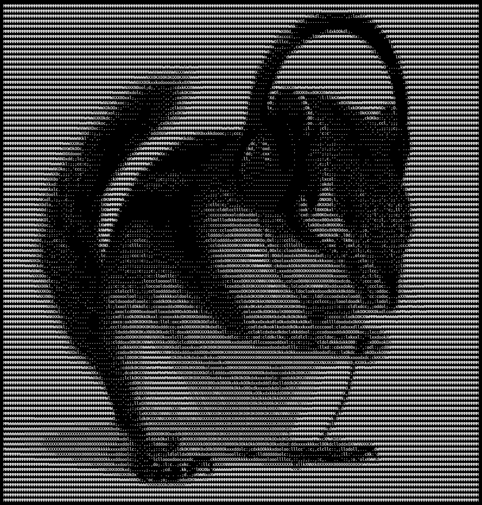

<table>
<tr>
<td>

</td>
<td>

<pre>
┌──────────────────────────────────────────────────────────┐
│ [■] ══════════  xnnkvr OS — System 1.0  ══════════ [_][✕]│
├──────────────────────────────────────────────────────────┤
│ XNNKVR ROM // 512K   USER: KENN XAVIER DABON             │
│                            ● OPEN TO OPPORTUNITIES       │
└──────────────────────────────────────────────────────────┘
</pre>

<h3><code>01 // ABOUT.DOC</code></h3>

<b>Kenn Xavier Dabon (<code>@xennkavier</code>)</b> — BS Information Technology student at <b>CIT-U</b>. 
Focused on <b>Frontend</b>, <b>Backend</b>, <b>Project Management</b>, and <b>Quality Assurance (QA)</b>.
<ul>
  <li><b>Currently working on:</b> <a href="https://marketplace.visualstudio.com/items?itemName=tallbreadstick.ariadne-extension-vscode"><b>Ariadne</b></a> — a student-first SAST extension for VS Code.</li>
  <li><b>Beyond the terminal:</b> Making beats in <b>FL Studio</b>.</li>
</ul>

<h3><code>02 // SKILLS_&_TOOLS.SYS</code></h3>

<table>
  <tr><td><code>/usr/bin/lang</code></td><td><code>Java</code> · <code>TypeScript</code> · <code>JavaScript</code> · <code>Python</code> · <code>C</code> · <code>Kotlin</code> · <code>HTML/CSS</code></td></tr>
  <tr><td><code>/sys/frameworks</code></td><td><code>Spring Boot</code> · <code>React</code> · <code>Next.js</code> · <code>Django</code> · <code>Tailwind CSS</code></td></tr>
  <tr><td><code>/opt/tools</code></td><td><code>Git</code> · <code>Postman</code> · <code>Jira</code> · <code>TestRail</code> · <code>Supabase</code> · <code>FL Studio</code></td></tr>
</table>

<h3><code>03 // HYPERCARD_DIRECTORY</code></h3>

<a href="https://www.linkedin.com/in/kenn-xavier-dabon/"><code>LinkedIn ↗</code></a> &nbsp;
<a href="mailto:kennxavier15@gmail.com"><code>Email ✉</code></a> &nbsp;
<a href="https://github.com/xennkavier13/xnnkvr"><code>xnnkvr OS Repo ↗</code></a>

</td>
</tr>
</table>
